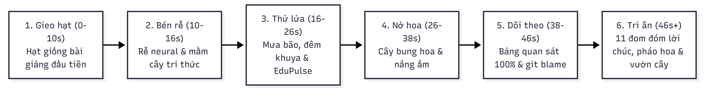

# Dear Teacher.exe — The Gratitude Pipeline

Thiệp tri ân Ngày Nhà giáo Việt Nam 20/11 kính tặng **Thầy TS. Bùi Quy Anh**.
Tác giả: **Trương Minh Thành** — *Happy Teachers' Day 20/11*.

Ẩn dụ chủ đạo: **“Trồng người” = một CI/CD Pipeline bền bỉ, nơi người Thầy kiên nhẫn gieo từng bài giảng và không bao giờ bỏ rơi học trò.**



## Cách mở thiệp (Zero-dependency, chạy ngay trong 3 giây)
1. **Mở trực tiếp (`file://`):** Giải nén và double-click `index.html` trên bất kỳ trình duyệt nào (không cần cài đặt, không cần mạng, font tiếng Việt nhúng cục bộ ~120KB).
2. **Cá nhân hóa qua URL:** `index.html?to=TS.%20Bùi%20Quy%20Anh`
3. **Chạy qua Docker (bonus DevOps):**
   ```bash
   docker build -t dear-teacher .
   docker run --rm -p 8080:80 dear-teacher
   ```

## Tương tác & Tính năng nổi bật (P0 + P1 + P2)
- **Đom đóm hình dáng thật & Quỹ đạo bay 3D quanh cây:** 11 chú đom đóm lớn vỗ cánh phát sáng quanh vòm tán đại diện cho 11 lời chúc thuần Việt (môn Điện toán đám mây, đề tài NCKH EduPulse, và câu nói truyền cảm hứng của Thầy), cùng đàn đom đóm nhỏ bay lượn vòng quanh cây theo quỹ đạo Lissajous ngẫu nhiên có vệt sáng đuôi. Lia chuột qua đom đóm lời chúc để xem tiêu đề, chạm vào để mở thẻ đọc chi tiết.
- **Phong cảnh Đồi núi Trời đêm nhiều lớp:** Bầu trời đêm sâu có Dải Ngân Hà mờ, Trăng lưỡi liềm tỏa quầng bạc, Sao băng, 4 tầng đồi núi có viền sáng ánh trăng (`ridge rim-light`), rừng thông xa, mặt hồ thung lũng lấp lánh và thảm cỏ tiền cảnh đung đưa theo gió.
- **Bố cục thông minh không che khuất:** Khi mở thẻ lời chúc bên phải, bảng Tâm thư bên trái tự động thu gọn (và ngược lại) để tán cây luôn thoáng đãng.
- **Click mặt đất gieo thêm cây con (P2):** Click vào vùng mặt đất dưới gốc cây để gieo thêm hạt và ngắm các cây con nở hoa trong khu vườn.
- **Konami Code & Pháo hoa Hoa Sen / Hoa Phượng (P2):** Bấm tổ hợp phím `↑ ↑ ↓ ↓ ← → ← → B A` hoặc bấm chip `pháo hoa` để bắn pháo hoa Hoa Sen & Hoa Phượng rực rỡ trên bầu trời đêm.
- **Lưu ảnh thiệp PNG (`📸 Lưu ảnh`, P2):** Xuất trực tiếp bức tranh cây tri ân kèm lời đề tặng Thầy và chữ ký tác giả ra file `.png` sắc nét.
- **Thanh tiến trình 6 chặng & `Skip ⏭ / Replay ↻`:** Click vào bất kỳ chặng nào ở đáy màn hình để nhảy tới chặng đó; ở chặng cuối nút `Skip` tự đổi thành `Replay ↻`.
- **Web Audio API (`🔊 Bật tiếng`):** Tự tổng hợp tiếng mưa, gió trầm và chuông gió ngũ cung mà không dùng bất kỳ file `.mp3` nào.
- **Observability Panel (phím `D`):** Hiển thị FPS, chặng hiện tại, số cành/lá/hạt và chỉ số `adaptive quality`.

## Cấu trúc thư mục
```text
DearTMTTeacher.exe/
├─ index.html
├─ css/style.css
├─ config/gratitude.config.js
├─ js/ (world.js, timeline.js, tree.js, particles.js, terminal.js, audio.js, dashboard.js, main.js)
├─ assets/fonts/ (Be Vietnam Pro & JetBrains Mono woff2 subset Latin + Vietnamese)
├─ docs/images/FlowProject.png
├─ tests/smoke.js
├─ Dockerfile
└─ .github/workflows/ci.yml
```
