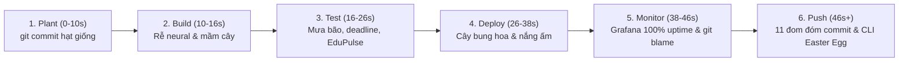

# Dear Teacher.exe — The Gratitude Pipeline

Thiệp tri ân Ngày Nhà giáo Việt Nam 20/11 gửi **Thầy TS. Bùi Quy Anh**.
Ẩn dụ chủ đạo: **“Trồng người” = một CI/CD Pipeline không bao giờ rollback học trò.**



## Cách mở thiệp (Zero-dependency)
1. **Mở trực tiếp (`file://`):** Giải nén `.zip` và double-click `index.html` trên bất kỳ trình duyệt nào (không cần cài đặt, không cần mạng, font tiếng Việt nhúng cục bộ).
2. **Cá nhân hóa qua URL:** `index.html?to=TS.%20Bùi%20Quy%20Anh`
3. **Chạy qua Docker (bonus DevOps):**
   ```bash
   docker build -t dear-teacher .
   docker run --rm -p 8080:80 dear-teacher
   ```

## Tương tác & Phím tắt
- **Thanh Pipeline ở đáy:** Click vào bất kỳ chặng nào (`Plant → Build → Test → Deploy → Monitor → Push`) để nhảy tới chặng đó.
- **`Space` / `→` hoặc nút `Skip ⏭`:** Chuyển nhanh qua chặng tiếp theo.
- **`D`:** Bật/tắt Observability Panel (FPS, scene, số cành/lá/hạt, adaptive quality).
- **`🔊 Sound`:** Bật/tắt âm thanh tự sinh bằng Web Audio API (tiếng mưa, gió trầm, chuông gió ngũ cung).
- **`🌙 Env: Production / ☀️ Staging`:** Chuyển đổi bầu không khí Ban đêm / Ban ngày.
- **Đom đóm trên tán cây (Cảnh Push):** Chạm vào từng đom đóm để đọc 11 commit tri ân (môn Điện toán đám mây, đề tài NCKH EduPulse, và câu nói của Thầy).
- **Terminal Easter Eggs:** Gõ hoặc bấm chip `git log`, `sudo thank-you`, `git blame`, `help`, hoặc gõ lệnh bất kỳ để xem `404: Lời cảm ơn not found → Redirecting to Lời cảm ơn found`.

## Cấu trúc thư mục
```text
DearTMTTeacher.exe/
├─ index.html
├─ css/style.css
├─ config/gratitude.config.js
├─ js/ (world.js, timeline.js, tree.js, particles.js, terminal.js, audio.js, dashboard.js, main.js)
├─ assets/fonts/ (Be Vietnam Pro & JetBrains Mono woff2 subset Latin + Vietnamese)
├─ tests/smoke.js
├─ Dockerfile
└─ .github/workflows/ci.yml
```
